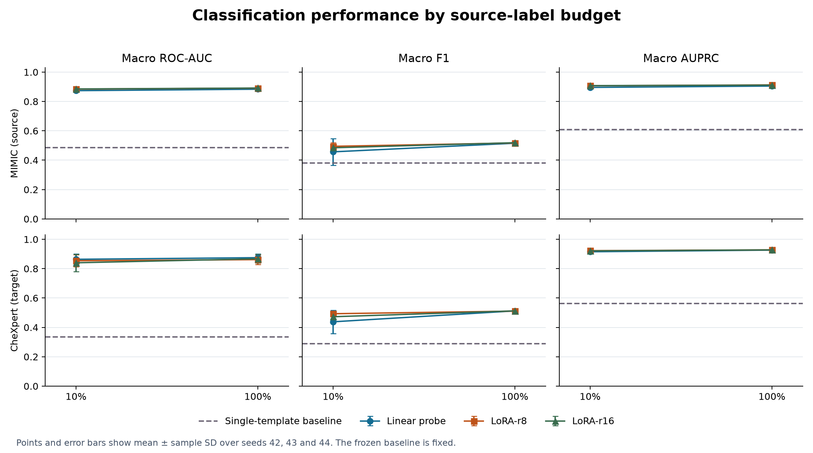
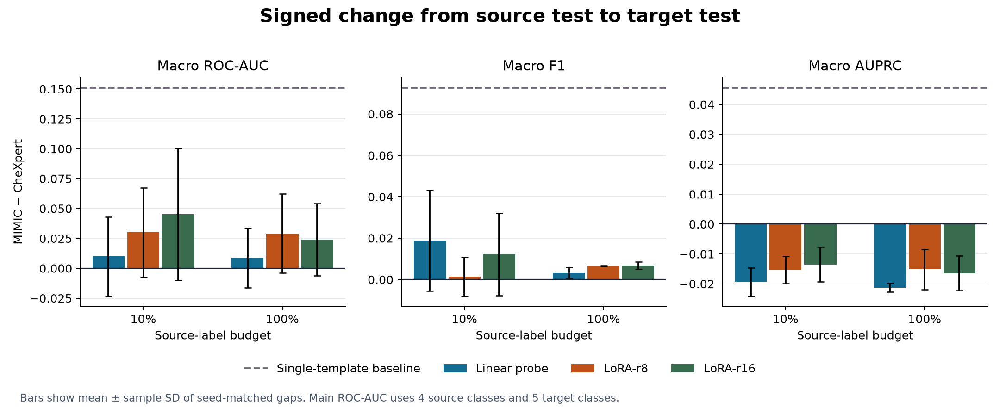

# Step 2A 分类评测与病例分析

LoRA 在两种标注预算下都取得了高于线性探针的源域 Macro-AUC，同时目标域 Macro-AUC 较低。10% 预算下，两种 LoRA 的目标域 F1 和 AUPRC 均高于线性探针。排序性能、固定阈值下的判决和精确率-召回率表现需要分别解释。

## 评测范围

从 Step 1 的正式预测重算指标。源域测试清单为 500 名患者，其中 206 名至少有一类有效标签。目标域测试清单为 1,000 名患者，其中 762 名至少有一类有效标签。使用逐类 mask 忽略不确定和缺失标签。两域独立评测，各域内不同模型的样本、有效标签和 mask 已对齐。

训练方法按源域 10% 和 100% 标注预算汇报，表中为种子 42、43、44 的均值 ± 样本标准差。单模板基线来自 `frozen_prompts`，每域只有一次固定推理结果。F1 阈值统一为 0.5。AUPRC 采用 Average Precision。代码通过原项目评测函数重算 38 份 A 部分预测，并核对了研读病例所用的 2 份五模板预测对应的 Step 1 汇总。

## 分类总表

| 方法 | 源域预算 | MIMIC AUC | MIMIC F1 | MIMIC AUPRC | CheXpert AUC | CheXpert F1 | CheXpert AUPRC |
|---|---|---:|---:|---:|---:|---:|---:|
| 原始预训练单模板 | 固定 | 0.4862 | 0.3819 | 0.6074 | 0.3352 | 0.2892 | 0.5618 |
| 线性探针 | 10% | 0.8737 ± 0.0057 | 0.4569 ± 0.0914 | 0.8959 ± 0.0071 | 0.8638 ± 0.0368 | 0.4381 ± 0.0796 | 0.9152 ± 0.0043 |
| LoRA-r8 | 10% | 0.8842 ± 0.0044 | 0.4946 ± 0.0233 | 0.9071 ± 0.0057 | 0.8541 ± 0.0414 | 0.4932 ± 0.0149 | 0.9225 ± 0.0087 |
| LoRA-r16 | 10% | 0.8853 ± 0.0037 | 0.4848 ± 0.0071 | 0.9079 ± 0.0046 | 0.8401 ± 0.0587 | 0.4727 ± 0.0128 | 0.9214 ± 0.0103 |
| 线性探针 | 100% | 0.8837 ± 0.0016 | 0.5156 ± 0.0072 | 0.9052 ± 0.0024 | 0.8748 ± 0.0261 | 0.5124 ± 0.0046 | 0.9264 ± 0.0016 |
| LoRA-r8 | 100% | 0.8909 ± 0.0066 | 0.5174 ± 0.0014 | 0.9128 ± 0.0090 | 0.8616 ± 0.0320 | 0.5109 ± 0.0016 | 0.9280 ± 0.0024 |
| LoRA-r16 | 100% | 0.8914 ± 0.0077 | 0.5193 ± 0.0010 | 0.9114 ± 0.0078 | 0.8674 ± 0.0295 | 0.5126 ± 0.0008 | 0.9278 ± 0.0024 |

原始预训练基线可在两个预算的合并总表中复用。分类总表的 AUC、F1、AUPRC 均为逐病种宏平均。完整的逐种子和逐病种结果见 [宏平均汇总](results/macro_summary.csv) 与 [逐病种表](results/class_summary.csv)。

## LoRA 的额外收益是否迁移

相比原始预训练单模板，三种训练方法在两域的三项宏平均指标均提高。进一步与线性探针对照，两种 LoRA 的源域 Macro-AUC 均值在四个「秩 × 预算」组合中增加 **0.0072–0.0116**，对应目标域减少 **0.0075–0.0237**。例如 10% 预算的 LoRA-r16 在源域增加 0.0116，在目标域减少 0.0237。相同预算的 LoRA-r8 目标域 F1 提高 0.0551，AUPRC 提高 0.0073。100% 预算时，三个训练方法的目标域 F1 相差不足 0.002。上述结果是本次固定数据与三个种子的描述性比较。结果可支持「相对线性探针的源域 AUC 增益未延续到目标域」这一部分 H1 观察。

### 两域参与 Macro-AUC 的病种不同

MIMIC test 的 Atelectasis 有 61 个有效阳性和 0 个有效阴性，ROC-AUC 记为 NA。因此主表 MIMIC Macro-AUC 使用 4 类，CheXpert 使用 5 类。CheXpert 的 Atelectasis 也只有 3 个有效阴性，解读该病种 AUC 时要同时看样本计数。

迁移下降量按同一方法、预算和种子先算「MIMIC test − CheXpert test」，再对种子取均值和标准差。主口径下三个训练方法的 Macro-AUC 迁移差值均为正，均值范围是 **+0.0088 到 +0.0452**。把两域都限制为 AUC 可定义的 4 个共同病种后，均值范围变为 **−0.0226 到 −0.0156**。所以报告迁移差值时应同时说明病种构成。两域内的 LoRA 与线性探针对比都使用各域同一组病种，仍可直接看相对增益。详细值见 [迁移下降与共同病种对照](results/transfer_summary.csv)。

两域的有效标签构成还影响 AUPRC 的比较。例如 Edema 在 MIMIC 有效标签中的阳性率是 37.8%，CheXpert 为 61.9%。这些比例按有效标签计算。它们描述各自测试切片的标签分布。[标签分布表](results/class_prevalence.csv)

逐病种图分别见 [10% 标注预算](results/figures/disease_profiles_10pct.png) 和 [100% 标注预算](results/figures/disease_profiles_100pct.png)。

## 病例结果和阅片状态

病例筛选同时要求病种的三种子平均 AUC 相对线性探针在源域提高、在目标域降低，且目标域某例至少在两个对应种子出现线性探针判对、LoRA 判错。共得到 5 名不同患者，集中在 100% 预算 LoRA-r16 的 Pleural Effusion。该配置在源域对线性探针的病种 AUC 差值约为 +0.0013，目标域约为 −0.0004。符合筛选条件的是该病种 462 个有效目标域标签中的 5 例，其中有 4 例假阴性和 1 例假阳性。这些病例用于说明固定阈值下出现的典型分歧。按病种的全部筛选计数见 [候选计数表](results/case_candidate_counts.csv)。

**原图复核状态：未复核。** 交接包未提供原始胸片。本节病例分析依据逐样本预测与数据清单，AP／PA 来自索引，设备标记和可见病灶未通过阅片确认。组内病例页记录了标签、各模型概率、阈值、索引体位和缺失标签。源域 AUC 提升来自独立队列的病种汇总。
